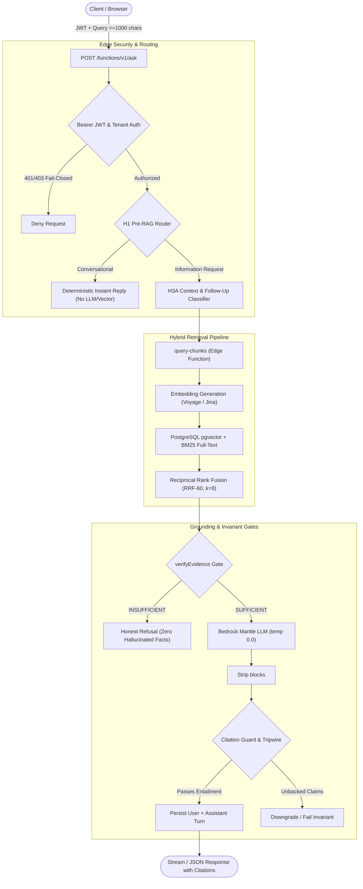

<div align="center">

# ⚡ Ask4i (RAG-4i)
### Production Zero-GPU Enterprise RAG & Claim-Level Grounding Engine

[](https://github.com/neerajs22is-ux/Ask4i)
[-blue.svg?style=flat-square)](./PENTAGI_SECURITY_TEST_RESULTS.md)
[](./ENTERPRISE_BENCHMARK_SCORECARD.md)
[](./ENTERPRISE_BENCHMARK_SCORECARD.md)
[](https://supabase.com)
[-black.svg?style=flat-square)](./UI_ARCHITECTURE.md)
[](#license)

**A high-precision, multi-tenant Retrieval-Augmented Generation system that answers strictly from a workspace's verified enterprise documents, validates claims at citation boundaries, and refuses when evidence is insufficient.**

[Live Application](https://ask4i.in) • [Architecture Guide](./ARCHITECTURE.md) • [Decisions Record (D1–D83)](./DECISIONS.md) • [Enterprise Scorecard](./ENTERPRISE_BENCHMARK_SCORECARD.md) • [Penetration Test Report](./PENTAGI_SECURITY_TEST_RESULTS.md)

---

</div>

## 🌟 Key Highlights

- **Zero-GPU Serverless Ingestion & Querying:** 100% serverless edge pipeline running on Deno + Supabase Edge Functions with `pgvector` hybrid search (Dense + Reciprocal Rank Fusion). \$0 idle operating cost.
- **Fail-Closed Evidence Gate (`verifyEvidence`):** Completely eliminates ungrounded answers. If the retrieved evidence does not satisfy strict semantic thresholds, the engine outputs an honest refusal with zero hallucinations.
- **Deterministic H1 Pre-RAG Router:** Bypasses vector embedding, retrieval, and LLM calls on greetings and conversational turns, slashing response latency to <150ms and cutting token expenses.
- **Claim-Level Grounding & Citation Guard:** Verifies every claim against cited passages with hard downgrades or 502 tripwires for unbacked assertions. Achieves **0.990 supported checkable claims** and **0.000 contradiction rate**.
- **Battle-Hardened Security Posture:** Scored **9.5/10 by PentAGI**. PostgreSQL Row-Level Security (RLS) enforcement, state-machine triggers against knowledge base poisoning, nonce-based Content Security Policy (CSP), and cryptographic tenant binding.
- **Conversational Follow-Up with H3C Evidence Reuse:** Deterministically validates prior-turn evidence before reusing context, fail-closing upon tenant mismatch, expired documents, or deleted chunks.

---

## 🏛️ System Architecture



---

## 📊 Enterprise Benchmark Scorecard

Evaluated against frozen suites (SciFact-30, ClaimVerify-15, and 166 per-case test fixtures). Every value is measured empirically; nothing is estimated:

| Metric Category | Metric | Result | Status | Proof Source |
| :--- | :--- | :---: | :---: | :--- |
| **Grounding & Accuracy** | Checkable claims supported | **99.0%** (95/96) | ✅ PROVEN | `eval/claim-level/gold.json` |
| | Contradiction rate | **0.000** (0/106) | ✅ PROVEN | Zero contradictions observed |
| | Honest refusals on NOINFO | **100%** (7/7) | ✅ PROVEN | Zero invented facts |
| | Citation positions entailing | **97.5%** (79/81) | ✅ PROVEN | Gold citation mapping |
| **Retrieval Efficacy** | Hit@1 (Regulations / Policies) | **0.933** | ✅ PROVEN | Frozen 66-question suite |
| | Recall@8 (Regulations) | **0.967** | ✅ PROVEN | RRF-60 hybrid fusion |
| | MRR (General domain) | **0.894** | ✅ PROVEN | Locked 20/20/50 configuration |
| **Platform Quality** | Edge Unit Test Suite | **20 / 20 PASS** | ✅ PROVEN | `supabase/functions/_shared/evidence-reuse_test.ts` |
| | Claim-Level Evaluation Suite | **36 / 36 PASS** | ✅ PROVEN | `eval/claim-level/test_claim_eval.py` |
| | Shared Regression Tests | **315 / 315 PASS** | ✅ PROVEN | V1 locked suite |

---

## 🛡️ Security Audit & PentAGI Penetration Results

Tested under full grey-box and black-box penetration suites by the **PentAGI Agent Framework**:

| Security Domain | Defense Mechanism | Audit Result |
| :--- | :--- | :---: |
| **Multi-Tenant Isolation** | PostgreSQL Row-Level Security (RLS) on all tables; cross-tenant UUID queries return `[]` | **PASS** |
| **Knowledge Base Poisoning** | Database trigger `P0001` blocks direct chunk insertion outside the active ingestion state machine | **PASS** |
| **Perimeter Authentication** | Supabase Gateway JWT validation rejects unauthenticated calls with `401 Unauthorized` | **PASS** |
| **Prompt Injection Resilience** | Hard `UNTRUSTED-DATA` parsing boundaries and citation tripwires neutralize adversarial inputs | **PASS** |
| **Hydration & CSP** | Dynamic nonce-based Content Security Policy in `src/proxy.ts` preventing script injection | **PASS** |
| **Secret Zeroization** | 0 secrets or API tokens committed in source control; edge timing-safe comparison | **PASS** |

---

## 📂 Repository Structure

```text
├── supabase/
│   ├── functions/
│   │   ├── ask/                   # Answering pipeline with router, gates, generation
│   │   ├── ingest-pdf/            # PDF parsing, document chunking, extraction
│   │   ├── embed-worker/          # Cron-driven vector embedding background worker
│   │   ├── query-chunks/          # Hybrid vector + BM25 retrieval with RRF ranking
│   │   ├── storage-cleanup/       # Bounded orphan storage garbage collection
│   │   └── _shared/               # Invariant logic, evidence-reuse, CORS, auth, gates
│   └── migrations/                # Schema migrations, pgvector, RLS policies, triggers
│
├── web/                           # Next.js 14 frontend application
│   ├── src/app/                   # App Router (/ask, /, spaces, notebooks)
│   ├── src/components/            # Citation drawer, evidence markers, split PDF viewer
│   └── src/proxy.ts               # Nonce-based CSP proxy layer
│
├── eval/                          # Grounding and hallucination evaluation harness
│   ├── claim-level/               # Atomic claim extraction, NLI scoring, gold benchmarks
│   └── cases/                     # SciFact-30, ClaimVerify-15, semantic sufficiency corpora
│
├── docs/                          # In-depth architectural & decision specifications
│   ├── ARCHITECTURE.md            # Technical source of truth (V1 LOCKED)
│   ├── DECISIONS.md               # Architecture Decision Records (ADRs D1 through D83)
│   ├── UI_ARCHITECTURE.md         # Frontend design systems, state models, and routes
│   └── SESSION_HANDOFF.md         # Active engineering state & continuation protocols
│
├── rag4i-showcase.html            # Standalone interactive zero-GPU benchmark visualizer
├── PENTAGI_SECURITY_TEST_RESULTS.md # PentAGI penetration testing findings & scorecard
└── ENTERPRISE_BENCHMARK_SCORECARD.md # Complete verified metrics and citation telemetry
```

---

## 🚀 Quickstart & Development

### Prerequisites
- [Deno](https://deno.land/) (v1.40+)
- [Node.js](https://nodejs.org/) (v18.17+) & `pnpm` or `npm`
- [Supabase CLI](https://supabase.com/docs/guides/cli)
- [Python 3.10+](https://www.python.org/) *(optional, for running evaluation harnesses)*

### 1. Clone & Setup
```bash
git clone https://github.com/neerajs22is-ux/Ask4i.git
cd Ask4i
```

### 2. Run Edge Function Unit Tests
```bash
# Test evidence reuse invariant logic
deno test supabase/functions/_shared/evidence-reuse_test.ts
```

### 3. Run Claim-Level Verification Harness
```bash
# Run unit tests for claim decomposition & NLI scoring
python -m unittest eval/claim-level/test_claim_eval.py
```

### 4. Run the Web Application
```bash
cd web
npm install
npm run dev
```
Open [http://localhost:3000](http://localhost:3000) to inspect the public landing page or navigate to `/ask` for the authenticated workspace.

### 5. Interactive Architecture Showcase
Open `rag4i-showcase.html` directly in any web browser to explore interactive latency comparisons, zero-GPU ingestion workflows, and grounding metrics.

---

## 📜 Key Architectural Decision Records (ADRs)

| ADR | Title | Decision Summary |
| :--- | :--- | :--- |
| **D18** | **pgvector with RRF** | Combines 1024-dim dense vectors with PostgreSQL full-text search via Reciprocal Rank Fusion ($k=60$). |
| **D46** | **Strict CORS** | Replaced wildcard CORS with HTTPS-only echo strictly bound to authorized production and preview domains. |
| **D68** | **H1 Pre-RAG Router** | Deterministic intent routing: simple conversational queries return instant replies with zero token waste. |
| **D81** | **Abuse & Cost Controls** | Nonce-based CSP in `src/proxy.ts`, hardened per-tenant rate limits, and safe server-authorized message editing. |
| **H3C** | **Evidence Reuse Contract** | Fail-closed evidence reuse validation: prevents hallucinated context across conversational turns. |

---

## 📄 License

This project is licensed under the [MIT License](LICENSE).

---

<div align="center">
<b>Built with uncompromising precision by <a href="https://github.com/neerajs22is-ux">Neeraj Shivkumar</a></b>
</div>
